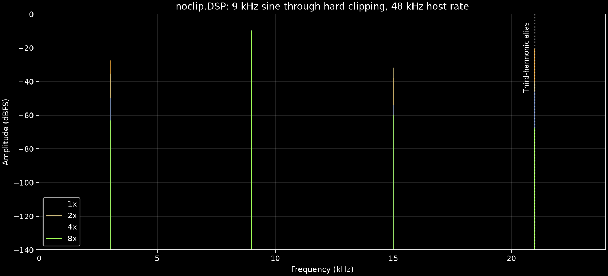

# noclip.DSP

A C++20/JUCE clipper and waveshaper for masters, aggressive drums and 808s.
**0.6.0 is a development build.** Windows and macOS VST3; AGPLv3.

## Download and install

Download the **Windows-x64-VST3.zip** asset from
[the Windows prerelease](https://github.com/eeshan-bhatia/NOCLIPDSP/releases/tag/v0.6.0).
Users do not need this repository or the source archive.

Close your DAW, extract the ZIP, and copy the entire `noclip.DSP.vst3` folder to
`C:\Program Files\Common Files\VST3\`. Reopen the DAW and rescan plugins.
Replace the old bundle when updating; do not copy only the binary inside it.
The ZIP includes installation instructions and a runtime download link if needed.
Requires Windows 10/11 x64 and a 64-bit VST3 host.

For macOS, use the **macOS-Universal-VST3.zip** asset from the
[macOS prerelease](https://github.com/eeshan-bhatia/NOCLIPDSP/releases/tag/v0.6.0-macos).
Close the DAW, extract the ZIP and copy the whole `noclip.DSP.vst3` bundle to
`~/Library/Audio/Plug-Ins/VST3/`, then rescan. It contains Apple Silicon and Intel
code, with a macOS 11 deployment target. Tests run on macOS 15; older macOS
versions and real Mac DAW sessions still need verification.

The macOS prerelease is ad-hoc signed, not Developer ID signed or notarized;
macOS may block it or require security approval. See
[Apple's guidance](https://support.apple.com/en-us/102445).
This is VST3, not Audio Unit, so Logic Pro cannot load it.

## Five independent sections

MASTER, LOW, MID, HIGH and 808 can be enabled independently,
and multiple sections can run together.

Signal order: input -> LOW/MID/HIGH in parallel -> MASTER -> 808 -> wet DC filter
-> global mix/output -> sample ceiling. Disabled bands pass their range through.
When all three bands are off, the crossover leaves the audible path.

Each of the four shaper sections provides CLIP and SHAPE processing.
Enable either or both; clipping precedes custom shaping. Drive, Threshold and
Stage Mix are shared. Built-in curve families, hardness, knee, nine editable
points, symmetry, inversion, presets, two curve endpoints and morph are retained
independently for every section.

808 provides Sub Preserve, Harmonics, Drive, Punch, Split and Output.
Oversampling, whole-plugin A/B and attenuation-only
RMS matching remain shared. **External sidechain has been removed.**

See [workflow and state notes](docs/WAVESHAPER_WORKFLOW.md),
[comparison guide](docs/COMPARISON.md) and [parameters](docs/PARAMETERS.md).

## Build

Install Visual Studio 2022+ Desktop development with C++, a Windows SDK, Git and
CMake 3.22+ (a version supporting your Visual Studio generator).

```powershell
cmake -S . -B build -G "Visual Studio 17 2022" -A x64
cmake --build build --config Release --parallel 2
ctest --test-dir build -C Release --output-on-failure
```

Use `Visual Studio 18 2026` for VS 2026. JUCE 9.0.5 is pinned at
`d60b7a78030661574a615b586d9325ba7a7fa7dd`; `NOCLIP_JUCE_PATH` selects a local checkout.

Outputs: `build/noclip.DSP_artefacts/Release/Standalone/noclip.DSP.exe` and
`build/noclip.DSP_artefacts/Release/VST3/noclip.DSP.vst3`. Close the DAW, replace the
whole VST3 bundle and rescan. Avoid installing both old and current bundles with
the same plugin ID. Native setup and pluginval: [BUILDING](docs/BUILDING.md).

## Validation and limits

Four CTest suites cover clipping, curve publication, state migration, independent
band shaping, latency, alias reduction, crossovers,
808 equivalence and allocation-free processing/quality changes.
Pluginval strictness level 5 checks the host-facing plugin.



In the documented 9 kHz clipping test at 48 kHz, a selected 21 kHz alias drops
about 47 dB from 1x to 8x. This is one controlled test, not a universal specification.
See [Phase 3/4 design and measurements](docs/PHASE34.md).

The ceiling is a sample clamp, not a true-peak limiter. A final sample guard catches
reconstruction overshoot but can itself introduce aliasing. Sub Preserve protects
a filtered low branch; it does not guarantee exact fundamental amplitude, and
output gain/ceiling still affect it. No LUFS, true-peak or dynamic limiter is claimed. RMS matching is an
approximation, not perceptual loudness normalization. FL Studio listening/project recall is not yet
validated by this build's automated tests.

Schema 6 saves every section and both whole-plugin snapshots. Earlier states
migrate with the compatibility limits described in WAVESHAPER_WORKFLOW.md. Output now spans -48..+24 dB; review Output automation from older
-48..+12 dB builds because normalized mappings changed.

[Progress](docs/PROGRESS.md) | [Architecture](docs/ARCHITECTURE.md) |
[Parameters](docs/PARAMETERS.md) | [Testing](docs/TESTING.md)

## License

[AGPLv3](LICENSE). JUCE is dual licensed under AGPLv3 or commercial terms:
[JUCE license](https://github.com/juce-framework/JUCE/blob/9.0.5/LICENSE.md),
[third-party inventory](https://github.com/juce-framework/JUCE/blob/9.0.5/JUCE.spdx.json).
Distribution outside AGPLv3 terms may require a commercial JUCE license.
Confirm redistribution permission for any externally supplied assets.
Dependencies, SDKs, caches and compiled binaries are ignored.
